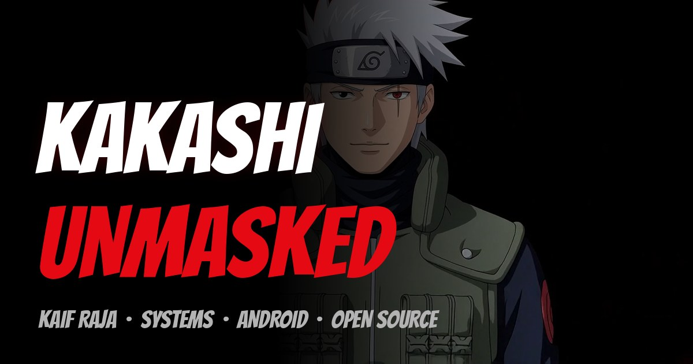

# Kakashi: Unmasked 🍥 — an anime-movie portfolio

    [](https://github.com/mkr-infinity/test/actions/workflows/quality.yml)



A cinematic, scroll-driven portfolio that plays like an anime film. Scroll to play the scene, stop and time stops with you, scroll up to rewind. Red smoke, a 3D skill drum, stacking mission cards, spinning seals and a credits roll at the end.

**More projects & guides:** [github.com/mkr-infinity](https://github.com/mkr-infinity) · [mkr-infinity.github.io](https://mkr-infinity.github.io/)

## Features

- 🎬 **Cinematic scroll** — pinned hero, scroll-scrubbed scenes, letterbox bars, film grain, credits roll
- 🥷 **3D WebGL stage** — React Three Fiber character backdrop with postprocessing
- 🎭 **5 full website skins** — Cinema / Arcade / Manga / Noir / Terminal: each swaps palette, font system, background world and structural treatment (two are complete light modes), not just colors; switchable from the nav, persisted in `localStorage`
- ⌨️ **Keyboard shortcuts** — `←`/`→` jump between chapters, `T` cycles the accent theme
- 🛰 **Field Guides chapter** — the real guide repos as first-class content
- ▶️ **Continue watching** — scroll progress persists per visitor; they can resume like a streaming app
- 📉 **Data-saver mode** — honors `Save-Data`/2G by loading fewer frames at low concurrency
- 🥚 **Easter eggs** — styled console message, ⏸ tab title when the visitor switches away
- 📱 **Fully responsive** — hamburger chapters menu on mobile, tuned down to 320px
- ♿ **Accessible** — focus-visible styles, focus trap + inert menu, skip link, `aria-current`, `prefers-reduced-motion`, touch-safe cursor
- 🔍 **SEO-ready** — metadata, OpenGraph/Twitter cards with a designed banner, JSON-LD, robots.txt + sitemap, themed 404, PWA manifest
- 🛠 **Manual-only CI** — a `workflow_dispatch` quality workflow (typecheck + build); nothing runs on push

## Tech Stack

- [Next.js 14](https://nextjs.org) (App Router) + TypeScript
- [React Three Fiber](https://docs.pmnd.rs/react-three-fiber) + drei + postprocessing (WebGL stage)
- [Framer Motion](https://www.framer.com/motion/) (scroll-linked animation)
- [Lenis](https://lenis.darkroom.engineering) (smooth scrolling)

## Make it yours (in 5 steps)

1. **Clone it**
   ```bash
   git clone https://github.com/mkr-infinity/test.git
   cd test
   ```
2. **Install & run**
   ```bash
   npm install
   npm run dev
   ```
   Open http://localhost:3000 🎬
3. **Put your story in** — change your name, links, projects, skills and story lines in `lib/data.ts`. Every section reads from there.
4. **Swap the photos** — replace the images in `public/stills/`, and put your character frames in `public/frames/hero-hd` and `public/frames/about-hd` (`001.webp`, `002.webp`, …).
5. **Put it online** — push to your GitHub and import it on [Vercel](https://vercel.com) (free, one click). Netlify or any cloud that runs Next.js works too.

## Project structure

```
app/                  # Next.js App Router pages, layout, global styles
components/
  sections/           # The movie: Billboard, Missions, Arsenal, Journey, Honors, Guides, Finale…
  stage/              # WebGL character stage and backdrop
  ui/                 # Nav, intro, custom cursor, smooth scroll, resume toast, easter eggs
lib/
  data.ts             # ✏️ ALL your content lives here
  frames.ts / store.ts / useScroll.ts   # Frame sequencing & scroll plumbing
public/
  frames/             # Image sequences for the scroll-driven scenes
  stills/             # Key art for the mission cards
  fonts/              # Display fonts
```

## Scripts

| Command | What it does |
|---|---|
| `npm run dev` | Start the dev server at `localhost:3000` |
| `npm run build` | Production build |
| `npm start` | Serve the production build |

---

<sub>Built with Next.js, Framer Motion, Lenis and a little WebGL. The anime character is fan art for a personal portfolio — use your own artwork if you publish commercially.</sub>
